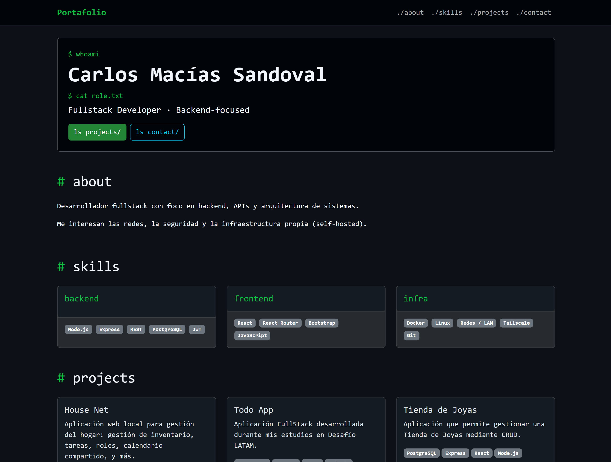

# Portafolio
Este es mi portafolio, puedes verlo visitando [**este enlace**](https://cmssandoval.github.io/portfolio).

Si llegaste aquí desde un sitio ajeno a GitHub, te invito a visitar mi perfil: **https://github.com/cmssandoval/**

## Demo

## Proyectos Colaborativos
En sus inicios, la finalidad de este repositorio era demostrar la capacidad de trabajar colaborativamente realizando forks de repositorios de portafolio de compañeros de Desafío LATAM, en este caso hice forks de mis compañeros [Diego Yañez](https://github.com/cmssandoval/Prueba-Desarrollo-de-Portafolio_Diego/commits/main/) y [Claudio Zuilt](https://github.com/cmssandoval/Desaf-o-6---Github-Pages-Claudio-Zuilt/commits/main/).